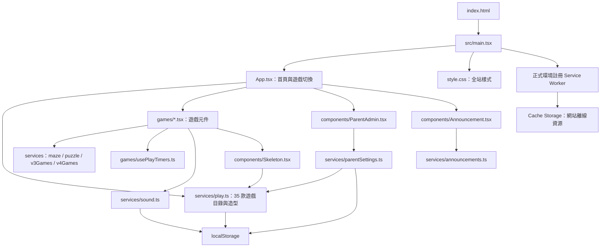

# Skeleton Playground 專案圖譜

建立日期：2026-10-17。以 commit `b44f371` 為基礎，已同步本機新增的怪獸塗鴉屋、怪獸小醫院與幽靈郵差。

## 專案定位

給幼兒與家長使用的萬聖節遊戲集合，共 35 款。採 React 19、TypeScript、Vite 6，為純前端靜態網站，沒有後端 API、資料庫或帳號同步。圖像以 SVG、Emoji 與 CSS 呈現，音效由 Web Audio 即時合成。

## 執行與資料關係

`App` 以 `game: GameId | null` 切換首頁與遊戲，沒有 URL router。遊戲元件靜態匯入，沒有依遊戲 lazy loading。造型由 App 傳入需要骨頭人的場景；變裝遊戲透過 callback 更新 App。切換遊戲會停止聲音並捲回頁頂，遊戲卸載後短暫狀態通常重設。

## 遊戲模組索引

| 元件檔案（src/games/） | 數量 | 遊戲 | 規則服務 |
| --- | ---: | --- | --- |
| AdventureGames.tsx | 3 | 幽靈迷宮、敲敲南瓜、骨頭人搭火箭 | maze.ts |
| ActionGames.tsx | 2 | 幽靈賽車、骨頭人射擊 | 元件內處理 |
| PartyGames.tsx | 4 | 骨頭人釣魚、幽靈接糖果、南瓜彈珠台、怪獸疊疊樂 | 元件內處理 |
| MoreGames.tsx | 4 | 骨頭人打鼓、南瓜彈跳床、小怪獸餵糖果、幽靈躲貓貓 | 元件內處理 |
| Games.tsx | 5 | 骨頭人跳舞、南瓜保齡球、幽靈泡泡、骨頭人變裝、糖果煙火 | play.ts 的保齡球工具 |
| V3Games.tsx | 4 | 怪獸冰淇淋店、骨頭人洗車場、南瓜小火車、怪獸小超市 | v3Games.ts |
| PuzzleGame.tsx | 1 | 南瓜拼圖王 | puzzle.ts |
| CareGames.tsx | 2 | 怪獸刷牙屋、怪獸吹風屋 | 元件內處理 |
| DiscoveryGames.tsx | 3 | 怪獸手電筒、南瓜搭橋、骨頭人溜滑梯 | 元件內處理 |
| CreativeGames.tsx | 3 | 怪獸塗鴉屋、怪獸小醫院、幽靈郵差 | 元件內處理 |
| V4Games.tsx | 4 | 南瓜橫向大冒險、骨頭人工地、怪獸節奏派對、怪獸寵物屋 | v4Games.ts |

各分組通常匯入對應 CSS；`Games.tsx` 的樣式由全站 `style.css` 提供。拼圖有六張圖片、五種難度；圖片位於 `public/puzzle-scene.svg` 與 `public/puzzles/`。

## 共用服務與持久化

| 模組 | 責任與資料 |
| --- | --- |
| services/play.ts | GameId、卡片目錄、Outfit 型別、造型驗證與保存、保齡球工具 |
| services/parentSettings.ts | 遊戲顯示清單的讀寫與過濾、家長密碼驗證 |
| services/sound.ts | 單例音效服務：解鎖音訊、音調、音效、舞曲、靜音及停止 |
| services/maze.ts | 三張迷宮與移動判定 |
| services/puzzle.ts | 建立拼圖、交換、歸位與完成判定 |
| services/v3Games.ts | 冰淇淋訂單、洗車階段、火車下一站、超市商品與購物清單 |
| services/v4Games.ts | 冒險障礙、積木歸位、節奏輸入與寵物需求 |
| services/announcements.ts | 公告陣列、最新公告、日期及 yyyyMMdd.vN 版號工具 |
| games/usePlayTimers.ts | 追蹤 setTimeout，元件卸載時清除；動畫 frame 與 interval 由各遊戲自行清理 |

| 儲存方式 | Key / 內容 | 生命週期 |
| --- | --- | --- |
| localStorage | nickson-skeleton-playground-v1：帽子、眼鏡、骨頭顏色 | 同一瀏覽器重新載入後保留 |
| localStorage | skeleton-enabled-games-v1：允許顯示的遊戲 ID | 同一瀏覽器保留；未保存時預設全部 |
| localStorage | skeleton-muted：靜音 | 同一瀏覽器保留 |
| React state / ref | 當前遊戲、分數、場景及短暫操作狀態 | 切換遊戲或重新載入通常重設 |
| Cache Storage | skeleton-playground- 加建置內容 hash | Service Worker 更新時清除同前綴舊快取 |

家長管理是本機遊戲顯示設定入口，固定密碼在前端驗證，不構成伺服器存取控制。儲存與快取均沒有跨裝置同步。

## 建置、離線與發佈

```mermaid
flowchart LR
  PUSH[push main 或手動啟動] --> ACTION[GitHub Actions：deploy.yml]
  ACTION --> INSTALL[npm ci / Node 22]
  INSTALL --> BUILD[npm run build]
  BUILD --> TS[tsc -b]
  TS --> VITE[vite build]
  VITE --> INJECT[inject-sw-assets.mjs]
  INJECT --> DIST[dist：靜態資源與已注入的 sw.js]
  DIST --> UNIT[npm test：Vitest]
  UNIT --> UPLOAD[上傳 Pages artifact]
  UPLOAD --> PAGES[GitHub Pages]
```

- 正式網址： https://kfed0526.github.io/skeleton-playground/
- `vite.config.ts` 的 base 固定為 `/skeleton-playground/`，改名稱或部署路徑時需同步調整。
- 建置腳本掃描 dist，將資源清單與內容 hash 寫入產出的 sw.js；`public/sw.js` 保留注入標記。
- Service Worker 安裝時預快取，啟用時清除舊版快取；導航請求先走網路，失敗時回退快取，其他同源 GET 資源先讀快取。
- `main.tsx` 僅在正式環境註冊 Service Worker，使用 build ID 檢查更新；已有 controller 的頁面在 controller 更換時重新載入一次。
- manifest 與圖示位於 public，支援加入主畫面。離線需先成功下載完整預快取資源。

## 驗證地圖

| 類型 | 入口 | 範圍 |
| --- | --- | --- |
| 單元測試 | src/services/*.test.ts | 遊戲規則、保存資料、家長設定與公告工具 |
| 公告渲染 | src/components/announcement.test.ts | 靜態渲染及無公告時不顯示 |
| 瀏覽器測試 | tests/*.spec.ts（含 creative-games.spec.ts） | 遊戲操作、觸控、版面、造型保存、家長管理、公告與離線 |
| 瀏覽器設定 | playwright.config.ts | Chrome、單 worker、預設 820×1180 觸控、4175 preview |
| CI | .github/workflows/deploy.yml | 建置與 Vitest；目前未執行 Playwright |

本機指令：`npm ci` → `npm run build` → `npm test` → `npm run test:browser`。開發使用 `npm run dev`，Windows 可用 `start-local.bat`。

## 後續修改入口

| 需求 | 首要檔案與連動 |
| --- | --- |
| 新增遊戲 | games 元件與樣式 → play.ts 的 GameId / games → App.tsx 匯入與顯示條件 → 對應測試與 README |
| 修改首頁或遊戲入口 | App.tsx、style.css；卡片文字與排序在 play.ts |
| 修改共用角色 | components/Skeleton.tsx、Outfit 與相關樣式 |
| 修改家長管理 | components/ParentAdmin.tsx、services/parentSettings.ts、parent-admin.spec.ts |
| 修改音效 | services/sound.ts 與遊戲呼叫處；留意使用者手勢解鎖與離開場景清理 |
| 發佈公告 | services/announcements.ts；最新公告放陣列最前面，內容分新增與修正 |
| 修改離線更新 | main.tsx、public/sw.js、scripts/inject-sw-assets.mjs、離線瀏覽器測試 |
| 修改部署 | deploy.yml、vite.config.ts、playwright.config.ts、README 的網址與指令 |

新增遊戲目錄與 App 掛載是兩處獨立登記，必須保持一致。V3Games.tsx、V4Games.tsx 集中多款遊戲，修改時依 export 元件定位，並檢查相應規則服務與分組 CSS。
